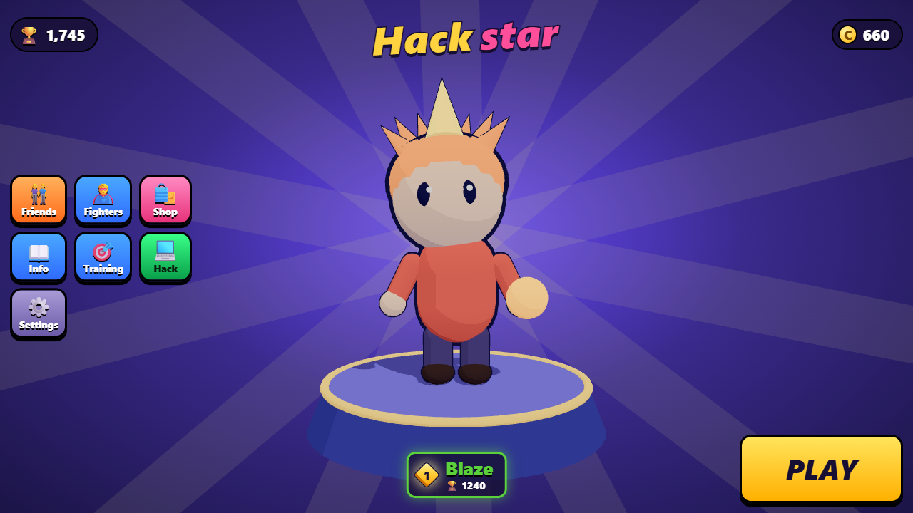
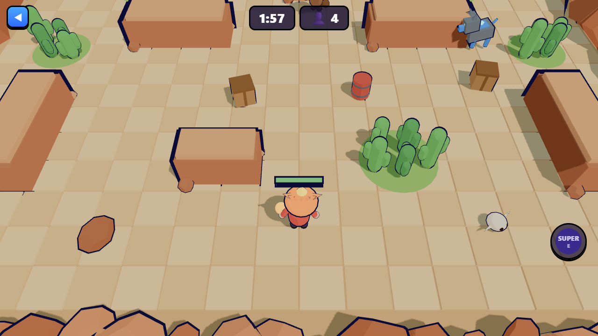

# Hack star

> **An example of [spec-nx](https://github.com/martinnordio/spec-nx) in use.** spec-nx is a
> small spec kit for building software with an AI coding assistant: every feature starts as a
> spec (requirements, then a plan in steps), each step is implemented, checked and committed,
> and the spec and the documentation are kept up to date along the way. How it was used here,
> the generated kit and links to every spec: **[SPEC-NX.md](SPEC-NX.md)**.

A top-down arena browser game for kids, with **hack codes** that give unlimited
credits, unlock every fighter and allow power levels up to 22. It runs on a desktop, iPad and
phone browser. Made by Martin Nordio and Mattia Nordio.

- Vision: [.specs/overall_req.md](.specs/overall_req.md)
- Feature list and MVP scope: [MVP and architecture spec](.specs/features/done/2026_11_12_mvp_and_architecture_spec.md)
- All specs: [.specs/features/](.specs/features/)
- How the code is organised: [docs/architecture.md](docs/architecture.md)

| Home | Match |
|------|-------|
|  |  |

## Layout

| Folder | What |
|--------|------|
| `server/` | Python game server (FastAPI) |
| `ui/` | Svelte UI with 3D graphics (Threlte / Three.js) |
| `docs/` | Documentation of how the game is built |
| `.specs/` | Specs, written with the spec kit in `.specs/kit/` |
| `.spec-nx/` | spec-nx (git submodule) |

## Prerequisites

- [uv](https://docs.astral.sh/uv/) — installs Python 3.13 for the server by itself
- [Node.js](https://nodejs.org/) 22 or newer

Clone with the submodule:

```powershell
git clone --recurse-submodules <repository url>
```

## Install

```powershell
cd server; uv sync; cd ..
cd ui; npm install; cd ..
```

## Run

In two terminals:

```powershell
cd server; uv run hack-star-server   # http://localhost:8180
cd ui; npm run dev                   # http://localhost:5180
```

Open <http://localhost:5180>. If the server is not running, the game shows "Cannot reach the
Hack star server" with a **Try again** button.

### What is there

- **Home:** the selected fighter in 3D with an entrance animation (tap to skip), trophies,
  credits and world coins, Prestige badge, **Play** and **Training**.
- **Play:** first the **world screen** (see **Worlds and world coins** below), then a match in
  the world you chose, last fighter standing, against 3 bots (other fighters; level
  and number of bots on the **Settings** screen):
  - "3, 2, 1, FIGHT!" countdown (showing for example "Easy · 3 bots"), then a 2-minute timer
    (red in the last 10 seconds) and the number of fighters still in.
  - Every fighter has a health bar (yours green, bots red); how much a hit takes depends on
    the fighter's power level and type (power 1 Basic: 480). After 3 seconds without being hit
    or shooting, health slowly comes back.
  - Bots fight you and each other. In the cacti you are see-through and bots far away cannot
    see you; bots hiding in cacti are invisible unless you are close.
  - **Super:** every 5 hits' worth of damage (on fighters or dummies) fills your Super (the ring around the
    **SUPER** button and the yellow bar over your fighter). Each fighter type has its own
    Super (see the table below). After 2 Supers the button turns
    purple (**HYPER**): the next Super is a **Hypercharge** — 5 seconds of purple glow, +25%
    speed and damage, and a bigger Super. Bots use Supers too (no Hypercharge on Easy).
  - **Overtime:** if the 2 minutes end and you and at least one bot are still in, "OVERTIME!"
    gives one more minute and every wall and cactus breaks apart, so nobody can hide.
  - The match ends with **Victory** (last one standing), **Defeat** (with your place) or
    **Time's up** (a draw, when overtime ends with others still in); then **Play again** or **Home**.
  - **Trophies:** a victory gives the fighter you played **+10 trophies** (a defeat or time's up
    gives none for now). The result screen counts them up and shows the bar to the next
    **Prestige** (1000, 2000, 3000…); reaching one shows "PRESTIGE n!" and the fighter gets the
    diamond badge with that number. A fighter never drops below a Prestige it reached.
    Training never changes trophies.
- **Training:** the same world screen, then the world with three target dummies (5 hits break
  one; it comes back after 5 seconds) to practise.
- **Worlds and world coins:** there are 13 worlds, each with its own name, look and layout, in
  three sizes. The world screen (before **Play**, **Training** and a room's **START**) shows
  them all; pick a size that is unlocked and tap **START**. The last choice is kept per account.

  | | Worlds |
  |---|--------|
  | Free (Small) | Canyon (the original arena), Jungle Ruins, Neon Docks |
  | To buy | Lava Forge, Sky Islands, Crystal Caves, Mini City, Kata Jungle, Candy Factory, Robot Workshop, Pirate Cove, Moon Base, Desert Oasis |

  | Size | Ground | Prices in **world coins** |
  |------|--------|---------------------------|
  | Small | like today's arena (30 × 24) | a new world: **500** (Small), **750** (Small + Medium) or **1000** (all three) |
  | Medium | about 1.5 times (36 × 30), more cover | the next size of a world you have: **250** each |
  | Large | about 2 times (42 × 34), more cover | Medium before Large; free worlds start in Small |

  The rules are the same everywhere (fighters, timer, overtime, Supers, rewards); bots that
  have seen nobody for 6 seconds walk towards the nearest fighter, so they find you in a Large
  world. Unlocking asks for a confirmation, and says how many more world coins are needed when
  there are too few.

  **World coins** are not credits: credits cannot buy worlds, `INFINITY` gives no world coins
  and `OPENSESAME` unlocks no world. You start with 0; every time your total trophies reach
  the next multiple of 500 (500, 1000, 1500, …) for the first time you get **250 world coins**
  (the result screen shows them), and a step is paid only once. Older saves get 250 for each
  500 trophies they had already reached. The balance is next to the credits on the home screen.

  Controls in matches and training:

  | | Move | Aim and shoot | Super |
  |---|------|---------------|-------|
  | Computer | WASD or arrow keys | Mouse to aim, click (hold to keep firing); Space shoots the nearest target | **E** or right click (towards the mouse), or click the Super button |
  | iPad / phone | Left thumb: joystick | Right thumb: drag to aim, let go to shoot; quick tap shoots the nearest target | Tap the Super button (aims at the nearest enemy) |
- **Fighters:** the 15 fighters with locks, trophies, power levels and type; open one to see
  it in 3D, read what its type does, try on its skins and choose or buy one. Every type has three
  fighters:

  | Type | Fighters | How it fights | Super |
  |------|----------|---------------|-------|
  | 🛡️ Tank | Rocko, Sir Clank, Mecha Max | Lots of health, short range | **Shockwave**: a ring of shots all around |
  | 🎯 Sharpshooter | Luna, Kira, Zeus Jr. | Very long range, less health, slower shots | **Piercing beam**: one huge shot through walls and every fighter on its way |
  | ⚡ Speedy | Turbo, Sparky, Marina | Runs 25% faster, shoots quickly | **Dash**: rushes forward and hits everyone on the way |
  | 💣 Thrower | Frosty, Coco, Spectra | Throws over walls; shots explode where they land (a ring shows where) | **Big bomb**: a huge explosion |
  | 🔥 Spreader | Blaze, Pixel, Drako | Three shots in a fan, best up close | **Super blast**: 5 big shots through walls |

  Blaze, Rocko, Turbo and Marina are unlocked at the start. Marina, Drako, Spectra, Mecha Max
  and Zeus Jr. are the newest and most detailed fighters (shiny and glowing parts, more moving
  parts). The types were tuned with bot-only test matches so that each one wins about as often
  as the others.
- **Create a fighter:** choose a name (1–12 characters), a type, two colours, a head (kid,
  robot, cat, dino, dome bot), a body (kid, robot, armour, hoodie, jet pack), hands (like the
  body, claws, big gloves) and legs (like the body, springs, big boots), with a turning 3D
  preview. The first fighter is free and
  usable right away. Changing a fighter costs 500 credits and keeps its trophies and power.
  While `CREATOR` is active, create up to 14 more fighters for 500 credits each; `INFINITY`
  makes creation and changes free. Extra fighters keep their progress but become inactive when
  `CREATOR` expires, and are usable again when it is entered again.
- **Skins for created fighters:** on a created fighter's screen, **New skin** makes up to 5
  skins, each with its own colours and parts (same name and type), for free. Choose one and
  **Select** to wear it at home, in matches and in rooms; **Change skin** and **Delete skin**
  (tap twice) are there too. Deleting the worn skin puts the default look back on.
- **Credits, unlocking and upgrading:** every match gives credits (**+100** for a victory, +20
  otherwise; you start with 500). On a fighter's screen:
  - **Unlock** a locked fighter for its price: Rare 160, Super Rare 430, Epic 925, Mythic 1900,
    Legendary 3800 credits.
  - **Upgrade** its power level for 20 × the current level (7 → 8 costs 140). Each level adds
    10% health and damage (power 1: ❤️ 3200 💥 480; power 11: 6400 / 960), and that is what the
    fighter has in matches and training. Bots play at power 5.
- **Shop:** buy skins with credits: Rare 100, Super Rare 200, Epic 300, Mythic 600, Legendary
  1500. Every fighter has at least 3 skins to buy. The **skin of the
  day** (a new one each day) is first and costs 30% less. Skins of locked fighters say
  "Unlock … first". After buying, **Wear it** puts it on and makes that fighter the chosen one.
  Skins can also be bought on the fighter screen (try on, then **Buy**). Default skins are free.
- **Info:** the words used in the game.
- **Settings:** the language (English, Deutsch, Schwiizerdütsch, Español, Italiano — per
  account; a new account starts in the browser's language), bot level (**Easy**, **Medium**,
  **Hard**) and number of bots (1–5) for every match (saved on the device; default Easy and 3
  bots), and **Reset coins and trophies**: after a confirmation the account starts again with
  0 credits, 0 trophies, 0 world coins, only the start fighters, the three free worlds in Small,
  power 1 and default skins (hack codes and
  created fighters stay; extra created fighters still need `CREATOR` to be active). The reset
  also forgets which world-coin codes were used, so they work again at once.
  **Music** turns the music on or off and chooses the track (saved on the device; on at
  first); it plays during every match and Training and pauses while the tab is hidden. The
  repository has no music, so it shows "Music is coming soon." until a developer adds tracks
  locally.
  **About Hack star** shows the version, the credits of the music and the MIT licence.
  **Developer mode** (with the developer code, see below) adds a link to the developer page.
- **Accounts:** the name under the trophies on the home screen. Tap it to switch account, add
  one (up to 5 per device, names 1–16 characters, all different) or rename one (accounts
  cannot be deleted). A name typed in the rename box is kept when the panel is closed. Each
  account has its own credits, trophies, fighters, skins, hack codes,
  created fighters and language. The progress saved before accounts existed became "Player 1".
  Existing saves migrate automatically, preserving the original created fighter and its progress.
  Same-origin tabs reconcile account changes and refresh when brought back to the front.
- **Friends:** play together, each on your own iPad, phone or computer on the same Wi-Fi — you
  and up to 2 friends **on one team against the bots**:
  1. One player taps **Friends → Create a room** and gets a 4-letter code and a QR code.
  2. Friends tap **Friends**, type the code and **Join**, or scan the QR code (with the game's
     **Scan QR** or the camera app, which opens the game straight into the room).
  3. The room shows Player 1 👑 (the host) and the friends with their fighters. The host taps
     **START**, picks the world on the world screen (friends play in it even if they have not
     unlocked it) and taps **START** again: friends take the place of bots (the host's Settings
     decide how many fighters in total, at least one bot) and everyone starts along the bottom
     of the arena. A friend on the previous version of the game can only play in Canyon Small:
     in any other world the server removes them with a message to update, and the host is told
     who and why.
  4. Shots never hurt teammates; teammates' health bars are blue. The team wins if one of you
     is the last one standing. Each player gets trophies and credits on their own device, and
     hacks work only on the device that entered them. Created fighters send their stable ID,
     name and look so friends see the same fighter.
  5. After the match, **Back to the room** to play again. If a friend leaves, a bot takes over
     their fighter; if the host leaves, the room closes and the friends get a draw.
- **Hack:** type a hack code or scan its QR code:

  | Code | Hack |
  |------|------|
  | `INFINITY` | Unlimited credits: unlocking, upgrading and skins are free |
  | `OPENSESAME` | Every fighter and skin unlocked (no need to buy skins) |
  | `POWER22` | Power levels up to 22 instead of 11 (power 22: ❤️ 9920 💥 1488 in matches) |
  | `HYPERCHARGE` | Your Super charges 3 times faster and every Super is a Hypercharge |
  | `CREATOR` | Allows up to 15 created fighters per account |

  `INFINITY`, `OPENSESAME`, `HYPERCHARGE` and `CREATOR` last 3 days; entering one again while
  active restarts its 3 days. `POWER22` is permanent. The Hack screen shows time remaining or
  the permanent status. The first created fighter stays usable without `CREATOR`; only extra
  fighters become inactive when that code expires.

  **Reset all hacks** on the same screen goes back to the normal rules: the real credits and
  the 11 limit come back; fighters, levels and skins you got while hacking stay (skins you
  only wore thanks to OPENSESAME go back to Default).

  **World-coin codes:** ten more codes (five that give **500** world coins and five that give
  **1000**) work like the others (typed or scanned) but give world coins and can be used by an
  account **once every 30 days**: the same code works again for that account 30 days after it
  was used, other accounts on the device have their own 30 days, and before that the game says
  from which date it works again. The Hack screen lists the codes this account used (partly
  hidden) with the date each works again, and the QR page shows all ten with their amounts. The
  codes, amounts and the 30 days are in `server/src/hack_star_server/world_codes.py`. Which
  codes were used is kept on the device, so clearing the browser's data lets them be used early.

Progress (accounts, chosen fighter, bought and chosen skins, trophies, hack expiry, created
fighters with their parts and skins, world coins, unlocked worlds and sizes, the chosen world
and the used world-coin codes) and the Settings choices are saved in the browser of each
device as soon as they change, so they are there after closing the game or turning off the
device. The game asks the browser to keep this data (Safari may otherwise delete it after
about a week without playing); when the browser does not allow saving (for example private
browsing) a notice says so once per visit. Open <http://localhost:5180/?gallery> to see
every fighter and skin side by side (`?gallery=custom` shows created-fighter parts,
`?gallery=worlds` all worlds; add `&world=lava-forge&size=large` for one).

### Match settings

Match length, overtime length (and whether it removes walls), default number of bots and bot
level (easy, medium, hard), what "time's up" means, the
trophies and credits for each result, prices (fighters and skins, skin-of-the-day discount), upgrade costs, power bonus, Super and Hypercharge numbers and the bots' power
level are in [ui/src/lib/game/settings.ts](ui/src/lib/game/settings.ts)
(`SETTINGS`). To try other values
without changing code, add them to the address, for example
<http://localhost:5180/?seconds=60&bots=5&level=medium&overtime=10> (1–8 bots, 5–600 seconds,
`overtime=0` turns overtime off). The address wins over the Settings screen.

### Play on an iPad or phone

1. Connect the iPad or phone to the same Wi-Fi as the computer.
2. `npm run dev` prints a `Network:` address for the Wi-Fi, for example
   `http://192.168.1.20:5180/`. Open it in Safari or Chrome on the device.
3. On Windows, allow Node.js through the firewall for private networks when asked.
4. To play with friends, every device opens the same **Network** address; the computer running
   the server and the UI is the meeting point (nothing goes outside the Wi-Fi).

### QR codes

Open `/?qr` with the **Network** address (for example `http://192.168.1.20:5180/?qr`), type
the password `M6D2` (asked every time; it keeps kids from printing the codes, it is not real
security: it is in this public code) and print the page. The QR codes contain a link to the
game with the code, so:

- the **camera app** of an iPad or phone opens the game and applies the hack directly;
- the game's **Scan QR** button needs the camera, which browsers allow only on `https://` (or
  `localhost`). For that, start the UI with `npm run dev:https` instead of `npm run dev` and open
  `https://<network address>:5180`; accept the certificate warning once (the certificate is
  self-signed). Print the QR page from that `https://` address too.

### Developer page

`/?dev` (for example <http://localhost:5180/?dev>) is for the developers; no button leads to
it for players. The first time it asks for the developer code (the same as the QR page,
`M6D2`), then the browser stays in **developer mode** until it is turned off in Settings.
It is in English.

- **Music:** the repository has **no music**; each developer adds tracks on their own
  computer, and they are never committed. The section lists the candidate tracks (up to 15)
  with title, author, licence (linked to its official page) and source; **Play** to listen, **Choose** up to ten for the
  game (only tracks marked CC0, CC BY with its version, e.g. `CC BY 3.0`, or made for Hack star), **Delete** the others, and a
  ready-to-copy request for the AI assistant to find more. Your candidates go in
  `ui/dev/music/candidates.local.json` and their MP3s in `ui/dev/music/files/`; choosing
  copies a track to `ui/public/assets/music/` and writes `ui/src/lib/music/tracks.local.json`,
  which the game and the About panel read. All of these are git-ignored; the repository's
  `candidates.json` and `tracks.json` stay empty (the page shows both lists together, your
  own entry winning). The recommended licences and what each one needs are in
  [ui/public/assets/LICENSES.md](ui/public/assets/LICENSES.md) — check each track's licence
  yourself. These tools work only with `npm run dev` and only from the computer running it.

## Test

```powershell
cd server; uv run pytest
cd ui; npm test; npm run check; npm run build
```

While the server is running on Windows, use `uv run --no-sync pytest` (the running server
locks its launcher, so `uv` cannot re-install it).

## Art

Only original art or art with a free licence (CC0) is used: every fighter, skin and arena is
built in code from simple shapes. See [ui/public/assets/LICENSES.md](ui/public/assets/LICENSES.md).
This repository contains no music: developers may add tracks on their own computer (see
**Developer page**), and are responsible for checking each track's licence themselves.

## Licence and disclaimer

Hack star is open source under the [MIT licence](LICENSE), © 2026 Martin Nordio and Mattia
Nordio.

Hack star is an independent fan project. It is not affiliated with, endorsed, sponsored or
approved by Supercell, and it contains no Supercell code, art, sound or other content. All
trademarks belong to their owners.
