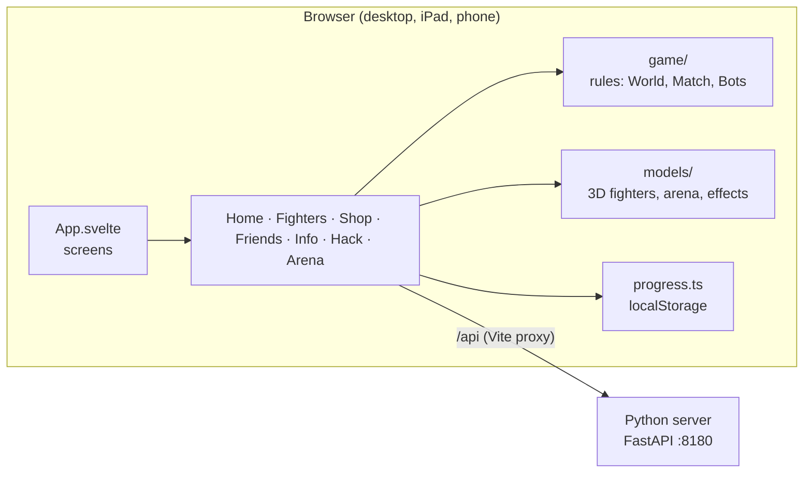
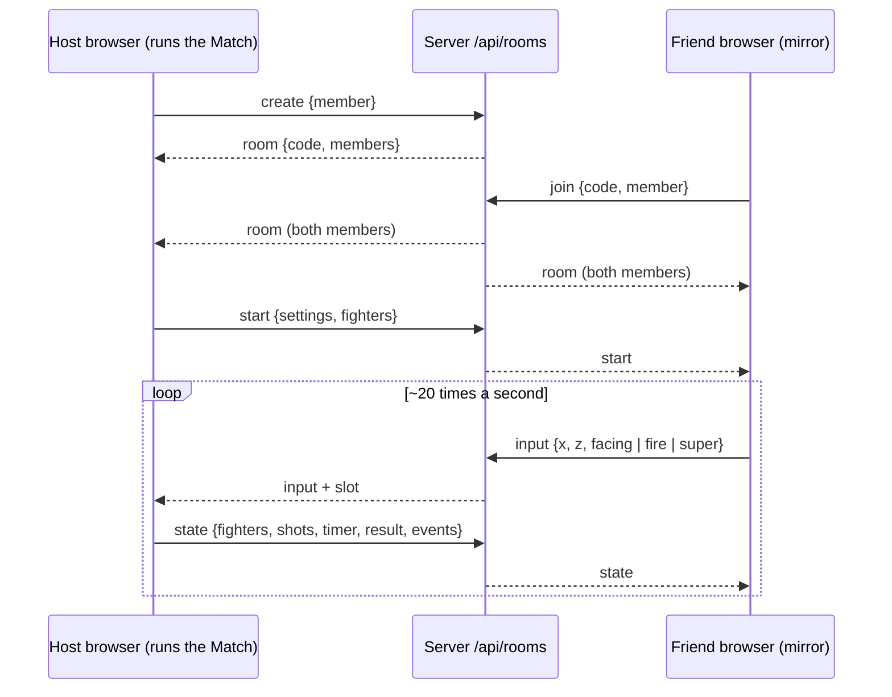

# Architecture

How Hack star is built, for anyone who changes it. What the game must do is in the specs
([.specs/features/](../.specs/features/)); this page explains where things are and how they fit.

## Two parts

| Part | Folder | Runs | Does |
|------|--------|------|------|
| Server | `server/` | Python 3.13, FastAPI, port 8180 | Game data: the fighter catalogue, hack codes; rooms for playing with friends |
| UI | `ui/` | Svelte 5 + Vite, port 5180 | Everything the player sees and plays; 3D with Threlte (Three.js) |

In development Vite forwards `/api/...` to the server, so the browser only talks to one
address (also from an iPad or phone on the Wi-Fi).

### Server API

| Endpoint | Returns |
|----------|---------|
| `GET /api/health` | `{"status": "ok"}` |
| `GET /api/fighters` | The 15 fighters with rarity, type and skins (`server/src/hack_star_server/fighters.py`; the 3 extra skins per fighter are in `MORE_SKINS`) |
| `GET /api/hacks` | The hack codes (`hacks.py`), for the printable QR page |
| `POST /api/hacks/redeem` `{"code"}` | The hack for a code (any case, spaces trimmed), or 404 "Unknown code" |
| `WS /api/rooms` | Rooms for playing with friends (`rooms.py`, see below) |

Single-player matches do **not** use the server: they run in the browser so Wi-Fi delays never
matter. Shared matches run in the host's browser; the server only passes messages.

## UI

### Screens (`ui/src/`)

`App.svelte` loads fighters and hacks from the server and switches screens with one `screen`
value (no router):

| Screen | File | Notes |
|--------|------|-------|
| Home | `lib/Home.svelte`, `lib/HomeScene.svelte`, `lib/AccountsPanel.svelte` | 3D fighter on a podium, entrance animation; the account chip opens the accounts panel (switch, add, rename) |
| Fighters / Fighter | `lib/FighterList.svelte`, `lib/FighterDetail.svelte` | Pictures come from `lib/portraits.ts` (one off-screen renderer, cached); skins can be tried on and bought |
| Create a fighter | `lib/CreatorScreen.svelte`, `lib/created.ts` | Name, type, colours, head, body with a live 3D preview; free the first time, `recreateCost` after |
| Shop | `lib/ShopScreen.svelte` | Skin of the day first, then every skin; buy, "NEW SKIN!", Wear it |
| Info | `lib/InfoPage.svelte`, `lib/vocabulary.ts` | The words used in the game |
| Settings | `lib/SettingsScreen.svelte`, `lib/options.ts` | Language (per account), bot level and number of bots (saved under `hack-star.options`), reset of the account |
| Hack | `lib/HackScreen.svelte`, `lib/QrScanner.svelte` | Codes typed or scanned; `/?qr` shows `lib/QrPage.svelte` |
| Friends | `lib/FriendsScreen.svelte`, `lib/net/room.ts` | Create / join a room (code, QR, `?room=CODE` link), lobby, Start |
| Match / Training | `lib/Arena.svelte` (HTML: joysticks, HUD, result), `lib/ArenaScene.svelte` (3D) | A new `Arena` is mounted per match |

Extra pages by address: `/?qr` (printable QR codes, after the password `M6D2` — checked in the
browser, a lock for kids, not security), `/?gallery` (all fighters and skins).

### Languages (`ui/src/lib/i18n/`)

Every text the player sees is a key in `en.ts`; `de.ts`, `gsw.ts` (Swiss German, Zurich),
`es.ts` and `it.ts` are typed `Record<TextKey, string>`, so a missing text fails
`npm run check`, and `i18n.test.ts` checks that none is empty and the `{placeholders}` match.
Components use `$t('key', { name })`; texts from the server (hack names and descriptions,
fighter ideas) go through `$tOr('hack.<id>.name', fallback)`, so the server stays English.
The language belongs to the current account (`language` store); a new account takes the
browser's language (`de-CH` → Swiss German). Fighter, skin and code names are not translated.

### Game rules (`ui/src/lib/game/`)

Plain TypeScript, no drawing, all tested with `vitest`:

| File | What |
|------|------|
| `arena.ts` | The canyon layout: walls, bushes (cacti), decorations, dummies, start points |
| `world.ts` | `World`: fighters (fighter 0 is the player) with health and damage from their power level and type, shots with owners (each shot carries its range, speed, size and damage, worked out when fired; lobbed shots fly over everything and explode; piercing shots go on after a hit), collisions (circles against rectangles), healing, knock-outs, dummies; its own `walls` / `bushes` lists, emptied by `removeCover()` (overtime); Super and Hypercharge: per-fighter `superCharge` / `hyperCharge` meters filled by damage dealt, `useSuper()` does the type's Super (blast, shockwave, beam, dash, bomb), `isHyper()` boosts speed and damage; emits events for effects |
| `types.ts` | `FIGHTER_TYPES` (Tank, Sharpshooter, Speedy, Thrower, Spreader) and `BASIC`: health, damage, speed and reload multipliers, the attack (range, shot speed, size, count, spread, lob, blast) and the Super; `fighterType(id)` |
| `tournament.ts` | Bot-only matches with one fighter per type, used by the fairness test |
| `match.ts` | `Match`: countdown, timer, overtime (when time runs out with the player and a bot in: `overtimeSeconds` more and `removeCover()`), result (victory, defeat with place, time's up) around a `World` |
| `bots.ts` | `Bots`: each bot picks the nearest fighter it can see, reacts after a delay, closes in, circles, shoots with an aim error (and uses its Super when full; `BotSkill.hyper` is off on Easy); wanders when it sees nobody |
| `controls.ts` | Input shared between the HTML layer and the frame loop (keys, mouse, joysticks, Super button / E / right click) |
| `trophies.ts` | `rewardFor(trophies, result, settings)`: trophies after a match with the Prestige floor; `applyReward()` saves them into the progress |
| `economy.ts` | Credits and power: `unlockPrice`, `upgradeCost`, `stats(level, settings, type)` (health and damage), `creditsFor(result)`, and the purchases `unlock()` / `upgrade()` (progress in, new progress or the reason out — not enough credits, max power, owned…); `powerOf()` caps a level at the current maximum |
| `shop.ts` | Skins: `ownsSkin` (default skins and the OPENSESAME hack count as owned), `wornSkin` (the chosen skin if owned, else Default), `skinOfTheDay(date)` (picked from the local day number, same for everyone that day), `skinPrice`, and the purchase `buySkin()` |
| `settings.ts` | `SETTINGS` (match length, bots, level, healing, trophies, credits, prices, power…) and `BOT_LEVELS`; `settingsFrom(search, defaults, chosen)` applies the Settings screen choices, then `?seconds=&bots=&level=&overtime=` |

Every frame (`ArenaScene.svelte`, `useTask`): input → `match.update(dt)` (bots think, world
steps) → events turned into effects → 3D objects moved to match the world. Per-frame data stays
in plain objects and Three.js meshes, not in Svelte state, to keep phones fast; only the HUD
gets a Svelte update, and only when a shown value changes.

### 3D models (`ui/src/lib/models/`)

Everything is built in code from simple shapes, so there is no art to download or license:

| File | What |
|------|------|
| `parts.ts` | Toon material, outline ("inverted hull"), shape helpers, cartoon eyes, Legendary glow; `shiny()` / `glowing()` materials and `move()` for parts with their own idle movement |
| `fighters3d.ts` | `buildFighter(id, skin)` for every fighter and skin; idle animation; see-through in bushes |
| `heroes3d.ts` | The five newest, more detailed fighters (Marina, Drako, Spectra, Mecha Max, Zeus Jr.) |
| `skins3d.ts` | The 3 extra skins of every fighter: the default look recoloured plus one extra part (crown, halo, horns, shades, scarf, backpack, cape) |
| `custom3d.ts` | The created fighter, built from its look (3 heads × 3 bodies × 2 colours) |
| `arena3d.ts` | Tiles, cliffs, rock walls, cacti, crates, barrels, skulls |
| `dummy3d.ts`, `healthBar.ts` | Training dummy; health bars |
| `particles.ts` | One pool of reused meshes for dust, flashes, sparks and pieces |

### Saved progress (`ui/src/lib/progress.ts`, `ui/src/lib/accounts.ts`)

Per device in `localStorage` (no login), under `hack-star.accounts`: up to 5 accounts, each
with a name, a language and its own progress, and which account is current. The `progress`
store (in `accounts.ts`) reads and writes the current account's progress, so the screens do
not know about accounts. The first time, the progress saved before accounts
(`hack-star.progress`, left in place) becomes "Player 1"; a new account starts with
`startProgress()` (500 credits, 0 trophies, `START_FIGHTERS`, which must match the server's
`unlocked_at_start`). `resetProgress()` is the Settings reset.

Each progress holds: credits, trophies and power level per fighter,
unlocked fighters, owned skins, active hacks, chosen fighter and skins, and the created
fighter's look. The format has a
`version` (now 4); versions 2 and 3 are migrated, and anything else that does not match falls
back to the starting progress. Hack effects are worked out when shown
(`lib/hacks.ts`: `credits`, `isUnlocked`, `maxPower`, `currentFighter`, `superHack` — applied to the player's fighter when an arena starts), so resetting the hacks
brings the normal rules back exactly.

Trophies change in one place: when a match ends, `Arena.svelte` works out the reward
(`game/trophies.ts`) and the credits (`game/economy.ts`) for the fighter that played and saves
them at once, before the result screen opens, so leaving then still keeps them; leaving during
a match or playing Training saves nothing. Prestige is not stored: it is
`prestigeLevel(trophies)` (every 1000).

Spending happens only on the fighter screen and in the Shop through `unlock()` / `upgrade()` /
`buySkin()`. With the
unlimited-credits hack nothing is taken from the saved credits, so resetting the hacks shows
the real amount again.

The player's options (bot level, number of bots) are not progress: `lib/options.ts` keeps them
under their own key `hack-star.options`, each bad value falling back to its default, so the
progress format did not change.

### The created fighter (`ui/src/lib/created.ts`)

Id `custom` in every account (`CREATED_ID`), added to the catalogue from the progress
(`withCreated`). Its look travels as its **skin id** (`lookSkin()`: "L" + type + head + body +
2 colours, 16 characters), so pictures, the 3D stage, the arena and rooms need nothing extra.
Only the `CREATOR` hack unlocks it (not credits, not OPENSESAME); bots never use it. In a room,
the member also sends its `name`; the server accepts `fighter: "custom"` only with a
look-shaped skin and a name.

### Playing with friends (`server/.../rooms.py`, `ui/src/lib/net/`)

- **Server** (`RoomManager`): rooms with a 4-letter code (no I or O), up to 3 devices, the host
  in slot 0. It checks each member (`{fighter, skin, power, hyper}`), refuses messages over
  64 KB, passes `start` / `state` / `lobby` from the host to the friends and `input` from a
  friend to the host. A friend leaving sends `left` to the host; the host leaving sends
  `closed` and removes the room. At most 100 rooms.
- **Rules**: every fighter has a `team` (people share team 0, each bot its own); shots,
  explosions and dashes never hurt the same team; `Match` gives the result for the player's
  team; `World.playerId` is the fighter this device controls; `teamArena()` starts the people
  along the bottom.
- **Host** (`HostMatch`): runs the real `Match`, puts each friend's fighter where the friend
  says, fires their shots and Supers, and sends a snapshot every 0.05 s with the events since
  the last one (so friends see the same effects). A friend who leaves becomes a bot
  (`Bots.addBot`); if the host leaves the match early, friends get a draw.
- **Friend** (`GuestMatch`): a mirror `World` with the same fighters. Its own fighter moves at
  once on the device (walls included) and the position goes to the host; everyone else glides
  to the snapshots and shots fly on between them. Shooting and Supers are requests to the host.
- `Arena.svelte` takes any `MatchLike` (local `Match`, `HostMatch` or `GuestMatch`); rewards
  are worked out and saved on each device from the team result.

## How to…

- **Change match settings:** edit `SETTINGS` in `ui/src/lib/game/settings.ts` (or try values
  with `?seconds=&bots=&level=&overtime=`); players choose bot level and number of bots on the
  Settings screen.
- **Add a fighter:** add it to `FIGHTERS` in `server/src/hack_star_server/fighters.py` (with
  its `type`) and its skins to `MORE_SKINS`, add a builder in `ui/src/lib/models/fighters3d.ts`
  (or `heroes3d.ts`), its skin variants in `skins3d.ts`, a shot colour in
  `ArenaScene.svelte` and its idea `fighter.<id>.idea` in the five dictionaries; check it with
  `/?gallery`.
- **Add or change a text:** add the key to `ui/src/lib/i18n/en.ts` and to `de.ts`, `gsw.ts`,
  `es.ts`, `it.ts` (`npm run check` lists the missing ones), then use `$t('key')`.
- **Add a language:** add its code to `LANGUAGES` / `LANGUAGE_NAMES` in
  `i18n/languages.ts`, a dictionary typed `Record<TextKey, string>` and its entry in
  `DICTIONARIES` (`i18n/index.ts`).
- **Change or add a fighter type:** edit `FIGHTER_TYPES` in `ui/src/lib/game/types.ts`, then
  run `npm test`: the fairness test fails if one type wins more than 30% or less than 10% of
  bot-only matches.
- **Add a hack code:** add it to `HACKS` in `server/src/hack_star_server/hacks.py`, add its id
  to `HackId` and its effect in `ui/src/lib/hacks.ts`.
- **Add a spec:** use the spec kit — `Load .specs/kit/requirements/prompt.md` →
  `REQUIREMENTS: <name> — <request>`, then `PLAN:`. Every spec also updates this page and the
  README.

## Tests

| Command | Covers |
|---------|--------|
| `cd server; uv run pytest` | API: fighters and skins, hacks, rooms (also the created fighter's look) |
| `cd ui; npm test` | Game rules, bots, match, trophies, credits and power, settings, progress, accounts, languages, created fighter, 3D models (detail of the new fighters, every new skin different), hacks, QR codes and password, vocabulary |
| `cd ui; npm run check` | Type checks (TypeScript and Svelte) |
