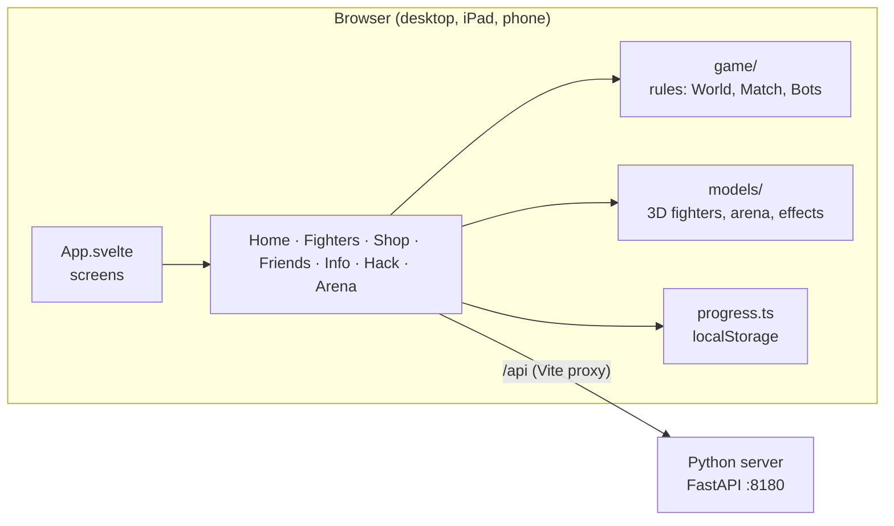
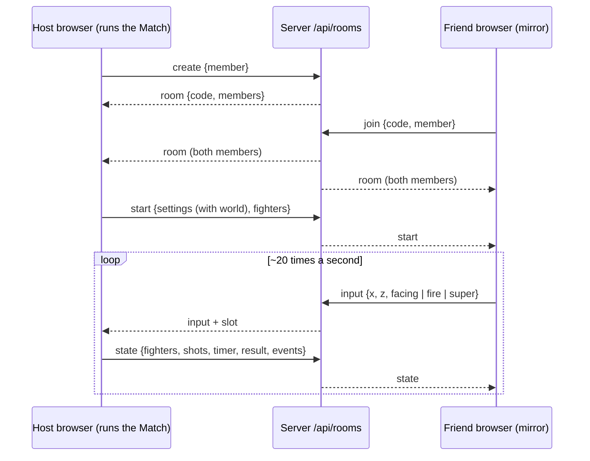

# Architecture

How Hack star is built, for anyone who changes it. What the game must do is in the specs
([.specs/features/](../.specs/features/)); this page explains where things are and how they fit.

## Two parts

| Part | Folder | Runs | Does |
|------|--------|------|------|
| Server | `server/` | Python 3.13, FastAPI, port 8180 | Game data: the fighter catalogue, hack codes and world-coin codes; rooms for playing with friends (with the host's world) |
| UI | `ui/` | Svelte 5 + Vite, port 5180 | Everything the player sees and plays; 3D with Threlte (Three.js) |

In development Vite forwards `/api/...` to the server, so the browser only talks to one
address (also from an iPad or phone on the Wi-Fi).

### Server API

| Endpoint | Returns |
|----------|---------|
| `GET /api/health` | `{"status": "ok"}` |
| `GET /api/fighters` | The 15 fighters with rarity, type and skins (`server/src/hack_star_server/fighters.py`; the 3 extra skins per fighter are in `MORE_SKINS`) |
| `GET /api/hacks` | The hack codes (`hacks.py`) and the world-coin codes (`world_codes.py`, with `world_coins` and `reuse_days`), for the printable QR page |
| `POST /api/hacks/redeem` `{"code"}` | The hack for a code (any case, spaces trimmed), or 404 "Unknown code"; a world-coin code answers with its `id`, `world_coins` and `reuse_days` |
| `WS /api/rooms` | Rooms for playing with friends (`rooms.py`, see below) |

Single-player matches do **not** use the server: they run in the browser so Wi-Fi delays never
matter. Shared matches run in the host's browser; the server only passes messages.

## UI

### Screens (`ui/src/`)

`App.svelte` loads fighters and hacks from the server and switches screens with one `screen`
value (no router):

| Screen | File | Notes |
|--------|------|-------|
| Home | `lib/Home.svelte`, `lib/HomeScene.svelte`, `lib/AccountsPanel.svelte` | 3D fighter on a podium, entrance animation; the account chip opens the accounts panel (switch, add, rename) |
| Fighters / Fighter | `lib/FighterList.svelte`, `lib/FighterDetail.svelte` | Pictures come from `lib/portraits.ts` (one off-screen renderer, cached); skins can be tried on and bought; a created fighter shows its own skins (new, change, delete, select) |
| Create a fighter | `lib/CreatorScreen.svelte`, `lib/created.ts` | Live turning 3D preview (head, body, hands, legs, two colours); first fighter is free and usable immediately, extras require `CREATOR` and cost 500 C each; edits cost 500 C (free with `INFINITY`); with a `skinId` it edits a created skin (colours and parts only, free) |
| Shop | `lib/ShopScreen.svelte` | Skin of the day first, then every skin; buy, "NEW SKIN!", Wear it |
| Worlds | `lib/WorldScreen.svelte`, `game/worldShop.ts` (`worldOffers`) | Opened by Play and Training before the match, and by the host of a room before START (`App.svelte`, screen `world`): every world with Small / Medium / Large buttons (unlocked: choose, saved at once; next size: price and confirmation; "N more world coins needed" when too few), the world-coin balance, **Start**; Home shows the balance next to the credits and the result screen "+N world coins" |
| Info | `lib/InfoPage.svelte`, `lib/vocabulary.ts` | The words used in the game |
| Settings | `lib/SettingsScreen.svelte`, `lib/options.ts`, `lib/AboutPanel.svelte` | Language (per account); bot level, number of bots, music on/off and track, developer mode (saved under `hack-star.options`); reset of the account; the About panel (version from `ui/package.json`, music credits, the repository's `LICENSE`) |
| Hack | `lib/HackScreen.svelte`, `lib/QrScanner.svelte` | Codes typed or scanned; world-coin codes (`hacks.ts`: `useWorldCode`, `usedWorldCodes`) add their coins and show the date they work again; `/?qr` shows `lib/QrPage.svelte` |
| Friends | `lib/FriendsScreen.svelte`, `lib/net/room.ts` | Create / join a room (code, QR, `?room=CODE` link), lobby, Start (the host chooses the world on the world screen first) |
| Match / Training | `lib/Arena.svelte` (HTML: joysticks, HUD, result), `lib/ArenaScene.svelte` (3D) | A new `Arena` is mounted per match; it plays in the account's chosen world and size (`chosenWorld` → `arenaFor`, with the world's theme and sky colours); a room is played in the host's world and size (`sharedArena` from the start message) |

Extra pages by address: `/?qr` (printable QR codes, after the password `M6D2` — checked in the
browser, a lock for kids, not security), `/?gallery` (all fighters and skins; `?gallery=custom`
for created-fighter parts; `?gallery=worlds&world=<id>&size=<size>` for each world's look, `lib/WorldGallery.svelte`), `/?dev` (`lib/dev/DevPage.svelte`, the developer page: asks the
same code once, then turns developer mode on in this browser; English only; one component per
section — `MusicSection.svelte`).

`App.svelte` also shows the saving notice (`lib/saving.ts`) once per visit when the browser
does not let the game save.

### Languages (`ui/src/lib/i18n/`)

Every text the player sees is a key in `en.ts`; `de.ts`, `gsw.ts` (Swiss German, Zurich),
`es.ts` and `it.ts` are typed `Record<TextKey, string>`, so a missing text fails
`npm run check`, and `i18n.test.ts` checks that none is empty and the `{placeholders}` match.
Components use `$t('key', { name })`; texts from the server (hack names and descriptions,
fighter ideas) go through `$tOr('hack.<id>.name', fallback)`, so the server stays English.
The language belongs to the current account (`language` store); a new account takes the
browser's language (`de-CH` → Swiss German). Fighter, skin and code names are not translated.

### Game rules (`ui/src/lib/game/`)

Plain TypeScript, no drawing, all tested with `vitest`:

| File | What |
|------|------|
| `arena.ts` | The `Arena` shape (walls, bushes, decorations, dummies, start and spawn points) and `CANYON`, the canyon layout = Canyon Small; other worlds come from `worlds.ts` |
| `worlds.ts` | The 13 `WORLDS` (id, `free`, `theme`, `seed`), `WORLD_DIMENSIONS` (Small 30 × 24, Medium 36 × 30, Large 42 × 34), `arenaFor(worldId, size)` with the seeded layout generator; see [Worlds](#worlds-catalogue-sizes-themes-and-shop) |
| `worldShop.ts` | World coins and worlds: `worldCoinsFor`, `earnWorldCoins`, `buyWorld`, `growWorld`, `worldCost`, `worldOffers`, `chosenWorld` / `chooseWorld` (see below) |
| `world.ts` | `World`: fighters (fighter 0 is the player) with health and damage from their power level and type, shots with owners (each shot carries its range, speed, size and damage, worked out when fired; lobbed shots fly over everything and explode; piercing shots go on after a hit), collisions (circles against rectangles), healing, knock-outs, dummies; its own `walls` / `bushes` lists, emptied by `removeCover()` (overtime); Super and Hypercharge: per-fighter `superCharge` / `hyperCharge` meters filled by damage dealt, `useSuper()` does the type's Super (blast, shockwave, beam, dash, bomb), `isHyper()` boosts speed and damage; emits events for effects |
| `types.ts` | `FIGHTER_TYPES` (Tank, Sharpshooter, Speedy, Thrower, Spreader) and `BASIC`: health, damage, speed and reload multipliers, the attack (range, shot speed, size, count, spread, lob, blast) and the Super; `fighterType(id)` |
| `tournament.ts` | Bot-only matches with one fighter per type, used by the fairness test |
| `match.ts` | `Match`: countdown, timer, overtime (when time runs out with the player and a bot in: `overtimeSeconds` more and `removeCover()`), result (victory, defeat with place, time's up) around a `World` |
| `bots.ts` | `Bots`: each bot picks the nearest fighter it can see, reacts after a delay, closes in, circles, shoots with an aim error (and uses its Super when full; `BotSkill.hyper` is off on Easy); wanders when it sees nobody, and after 6 seconds without seeing anyone walks towards the nearest opponent (big worlds) |
| `controls.ts` | Input shared between the HTML layer and the frame loop (keys, mouse, joysticks, Super button / E / right click) |
| `trophies.ts` | `rewardFor(trophies, result, settings)`: trophies after a match with the Prestige floor; `applyReward()` saves them into the progress |
| `economy.ts` | Credits and power: `unlockPrice`, `upgradeCost`, `stats(level, settings, type)` (health and damage), `creditsFor(result)`, and the purchases `unlock()` / `upgrade()` (progress in, new progress or the reason out — not enough credits, max power, owned…); `powerOf()` caps a level at the current maximum |
| `shop.ts` | Skins: `ownsSkin` (default skins and the OPENSESAME hack count as owned), `wornSkin` (the chosen skin if owned, else Default), `skinOfTheDay(date)` (picked from the local day number, same for everyone that day), `skinPrice`, and the purchase `buySkin()` |
| `settings.ts` | `SETTINGS` (match length, bots, level, healing, trophies, credits, prices, power, world-coin amounts and world prices…) and `BOT_LEVELS`; `settingsFrom(search, defaults, chosen)` applies the Settings screen choices, then `?seconds=&bots=&level=&overtime=` |

Every frame (`ArenaScene.svelte`, `useTask`): input → `match.update(dt)` (bots think, world
steps) → events turned into effects → 3D objects moved to match the world. Per-frame data stays
in plain objects and Three.js meshes, not in Svelte state, to keep phones fast; only the HUD
gets a Svelte update, and only when a shown value changes.

### Worlds: catalogue, sizes, themes and shop

Worlds are game data in `ui/src/lib/game/worlds.ts` and `game/worldShop.ts`; the look of each
theme is in `ui/src/lib/models/arena3d.ts`. Names are never saved: a world is saved by its id
(`canyon`, `jungle-ruins`, …), and its name is the text key `world.<id>.name`, so names can be
translated or changed freely.

- **Sizes:** `small`, `medium`, `large`. `WORLD_DIMENSIONS` gives Small 30 × 24 (today's arena),
  Medium 36 × 30 (about 1.5 times its ground) and Large 42 × 34 (about 2 times). The fighters,
  bots, overtime and Training read the `Arena` shape and its size, so they work unchanged.
- **Layouts:** `arenaFor(worldId, size)` returns `CANYON` for Canyon Small, and otherwise a
  seeded layout (`generate()`, the world's `seed` and size index): mirror-symmetric pairs of
  walls and bushes (`COVER`: 3 + 3 for Small, 5 + 4 for Medium, 7 + 6 for Large), decorations
  on free spots, spawns around the edge, and the start and dummies as in Canyon. Walls and bushes
  keep a gap from each other, from the spawns and from the centre. The same world and size always
  give the same layout; `worlds.test.ts` checks every world × size.
- **Themes:** `WORLD_LOOKS` (`arena3d.ts`) maps a `WorldTheme` to its colours, sky, edge kind,
  wall kind and cover kind. `buildArena(arena, theme)` draws it from simple shapes (no art files);
  the walls, cover and border are merged into a few meshes, so Large worlds stay smooth.

  | Theme | World | Edge | Walls | Cover |
  |-------|-------|------|-------|-------|
  | `canyon` | Canyon | cliffs | rock | cactus |
  | `ruins` | Jungle Ruins | trees | ruin | fern |
  | `neon` | Neon Docks | water | crates | post |
  | `lava` | Lava Forge | cliffs | rock (glowing) | crystal |
  | `sky` | Sky Islands | clouds | blocks | cloud |
  | `crystal` | Crystal Caves | cliffs | crystal | mushroom |
  | `city` | Mini City | buildings | house | hedge |
  | `kata` | Kata Jungle | trees | logs | fern |
  | `candy` | Candy Factory | lollipops | blocks | lollipop |
  | `robot` | Robot Workshop | buildings | machine | post |
  | `pirate` | Pirate Cove | water | crates | palm |
  | `moon` | Moon Base | cliffs | machine | crystal |
  | `oasis` | Desert Oasis | dunes | ruin | palm |

- **Free worlds:** the three with `free: true` (Canyon, Jungle Ruins, Neon Docks) are unlocked in
  Small for every account (`startWorlds()` in `progress.ts`).
- **Prices and earning:** `SETTINGS` (`settings.ts`): `worldCoinsPerStep` 250,
  `trophiesPerWorldStep` 500, `worldPrices` `{ small: 500, medium: 750, large: 1000 }`,
  `worldSizeStep` 250. `worldShop.ts` holds the rules and never reads or writes credits:
  `worldCoinsFor(totalBefore, totalAfter, steps)` gives the coins of each new 500-step (once, via
  `worldSteps`), `earnWorldCoins()` applies it to a progress, `worldCost(from, to)` is the price,
  `buyWorld()` / `growWorld()` return the new progress with the cost, or the reason for a refusal
  (`locked`, `owned`, `unknown`, or `world-coins` with the `missing` amount). `worldOffers()`
  gives the three size buttons of the world screen; `chosenWorld()` returns the saved choice when
  it is still unlocked (else Canyon Small), and `chooseWorld()` keeps a new one.

### 3D models (`ui/src/lib/models/`)

Everything is built in code from simple shapes, so there is no art to download or license:

| File | What |
|------|------|
| `parts.ts` | Toon material, outline ("inverted hull"), shape helpers, cartoon eyes, Legendary glow; `shiny()` / `glowing()` materials and `move()` for parts with their own idle movement |
| `fighters3d.ts` | `buildFighter(id, skin)` for every fighter and skin; idle animation; see-through in bushes |
| `heroes3d.ts` | The five newest, more detailed fighters (Marina, Drako, Spectra, Mecha Max, Zeus Jr.) |
| `skins3d.ts` | The 3 extra skins of every fighter: the default look recoloured plus one extra part (crown, halo, horns, shades, scarf, backpack, cape) |
| `custom3d.ts` | The created fighter, built from its look: 5 heads × 5 bodies × 3 hands × 3 legs × 2 colours. Each body is a torso with its own arms and legs; hands and legs 0 use them, 1–2 replace them (claws, big gloves; springs, big boots), so looks saved before hands and legs existed draw exactly as before (`custom3d.test.ts` pins them) |
| `arena3d.ts` | `buildArena(arena, theme)`: tiles, border, walls, cover and crates, barrels, skulls in the colours and shapes of the world's theme (`WORLD_LOOKS`: canyon cliffs and cacti, ruins and ferns, docks and neon posts…); walls, cover and border are merged by material into a few meshes so Large worlds stay smooth |
| `dummy3d.ts`, `healthBar.ts` | Training dummy; health bars |
| `particles.ts` | One pool of reused meshes for dust, flashes, sparks and pieces |

### Saved progress (`ui/src/lib/progress.ts`, `ui/src/lib/accounts.ts`)

Per device in `localStorage` (no login), under `hack-star.accounts`: up to 5 accounts, each
with a name, a language and its own progress, and which account is current. The `progress`
store (in `accounts.ts`) reads and writes the current account's progress, so the screens do
not know about accounts. The first time, the progress saved before accounts
(`hack-star.progress`, left in place) becomes "Player 1"; a new account starts with
`startProgress()` (500 credits, 0 trophies, `START_FIGHTERS`, which must match the server's
`unlocked_at_start`). `resetProgress()` is the Settings reset.

Each progress holds: credits, trophies, power levels, unlocked fighters, owned skins, active
hacks and their expiry timestamps, chosen fighter and skins, and a collection of created
fighters (look and up to 5 created skins), and the world fields: `worldCoins`, `worldSteps` (the
500-steps already paid), `worlds` (`Record<worldId, size>`: the biggest unlocked size of each
world), `selectedWorld` (`{ id, size }`) and `worldCodes` (`Record<codeId, nextUseAt>`). The
progress format is version 8. Formats v2 through v7 migrate forward: v7 gets the world fields (the
three free worlds in Small, Canyon Small chosen, `worldSteps = floor(trophies / 500)` and 250 world
coins for each step already reached); v6 looks get hands and legs 0 (the body's own) and no skins. The v5 single
created fighter keeps id `custom` and its trophies, power, skins and selection; v4 and earlier
active timed hacks receive their initial 72-hour expiry. Same-origin tabs reconcile local
changes with the latest saved state, listen for `storage` events, and refresh when visible.
Concurrent credit changes are merged as deltas; created skins merge by id like created
fighters (a skin id added in two tabs gets the next free id). Worlds merge across tabs in
`mergeProgress()`: `worldCoins` as a delta like credits, plus a refund when this tab paid for a
world the other tab had already bought (`worldRefund()`); `worlds` keeps the bigger size per
world; `worldSteps` the larger value; `worldCodes` the later date per code; `selectedWorld` the
local choice. A reset in one tab removes the keys it cleared (`mergeLargest()`), so it wins
over the other tab's older values. Hack effects are worked out when shown
(`lib/hacks.ts`: `credits`, `isUnlocked`, `maxPower`, `currentFighter`, `superHack` — applied to the player's fighter when an arena starts), so resetting the hacks
brings the normal rules back exactly.

Trophies change in one place: when a match ends, `Arena.svelte` works out the reward
(`game/trophies.ts`) and the credits (`game/economy.ts`) for the fighter that played and saves
them at once, before the result screen opens, so leaving then still keeps them; leaving during
a match or playing Training saves nothing. Prestige is not stored: it is
`prestigeLevel(trophies)` (every 1000).

World coins are paid in the same place: `Arena.svelte` `saveReward` calls `earnWorldCoins()`
with the total trophies from before the match, so each new 500-step pays once, and it keeps the
amount in `earnedWorldCoins` for the result screen.

Spending happens only on the fighter screen and in the Shop through `unlock()` / `upgrade()` /
`buySkin()`. Worlds are bought and grown only on the world screen, with world coins, through
`buyWorld()` / `growWorld()`. With the
unlimited-credits hack nothing is taken from the saved credits, so resetting the hacks shows
the real amount again.

The player's options (bot level, number of bots, music, track, developer mode) are not
progress: `lib/options.ts` keeps them under their own key `hack-star.options`, each bad value
falling back to its default.

Saving (`lib/saving.ts`): every change is written at once; `saveAccounts` / `saveOptions`
report whether it worked. `browserStorage()` returns `null` when the browser blocks
`localStorage` (reading it can throw), and the game then runs on memory storage. A failed save
shows the notice once per visit. On start `keepSavedData()` calls `navigator.storage.persist()`
so the browser does not delete the data after a while.

### Hack duration (`server/src/hack_star_server/hacks.py`, `ui/src/lib/hacks.ts`)

The server returns `duration_seconds` with each hack. `INFINITY`, `OPENSESAME`, `HYPERCHARGE`
and `CREATOR` last 72 hours; `POWER22` has no expiry. Re-entering an active timed code resets
its expiry to 72 hours from that redemption. The Hack screen derives active status from the
saved expiry, displays days and hours or a permanent label, and refreshes hourly, when visible,
and at the next expiry boundary.

### World-coin codes (`server/.../world_codes.py`, `ui/src/lib/hacks.ts`)

`world_codes.py` holds `WORLD_CODE_REUSE_DAYS = 30` and `WORLD_CODES`: ten `{ id, code, amount }`,
five of 500 and five of 1000 world coins. `hacks.py` adds one `Hack` per code to `ALL_HACKS`, with
`world_coins` and `reuse_days` set (the five normal hacks have neither), so `/api/hacks` and
`/api/hacks/redeem` include them without other server code. In the UI, `isWorldCode()` recognises
them; `useWorldCode(progress, hack, now)` adds the coins and stores `worldCodes[id] = now +
reuse_days` (the used date, per account); before that date it answers `wait` with the date, and
the Hack screen shows it. `usedWorldCodes()` lists the codes that cannot be used yet. Only the
Settings reset clears the dates; "Reset all hacks" does not.

### The created fighter (`ui/src/lib/created.ts`)

The collection has up to 15 entries: the first keeps id `custom` and is always usable; extras
use ids `custom-2` through `custom-15`, require active `CREATOR`, and become inactive when it
expires without losing their progress. `withCreated()` adds them to the catalogue. Each look
travels as its **skin id** (`lookSkin()`: "L" + type + head + body + 2 colours, 16 characters
— or, with head or body above 2 or other hands or legs, "L" + type + head + body + hands +
legs + 2 colours, 18 characters), so pictures, the 3D stage, the arena and rooms need nothing
extra; looks an older version can draw keep the 16-character form. The server accepts both.
Bots never use created fighters.

Created skins (`addCreatedSkin`, `changeCreatedSkin`, `deleteCreatedSkin`,
`chooseCreatedSkin`): up to 5 per created fighter, ids `s1`…`s5`, free, each with its own
colours and parts; the chosen one is in `selectedSkins[fighterId]` and `wornSkin()` returns
its look with the fighter's type, so rooms and models get it like any look.

### Music (`ui/src/lib/music/`, `ui/dev/`)

| File | What |
|------|------|
| `music/candidates.ts` | Rules shared by the game and the dev server: allowed licences (CC0, CC BY with its version, made for Hack star), `licenceUrl()` (official licence page), at most 10 chosen and 15 candidates, no delete of a chosen track, `shipped()`, `mergeCandidates()` (repository list + local list, local wins) |
| `music/tracks.json`, `music/tracks.ts` | `TRACKS`: `tracks.json` (repository, always empty) together with the optional, git-ignored `tracks.local.json` written by the developer page (`import.meta.glob`, so a missing local file is fine); read by Settings, the player and the About panel |
| `music/player.ts` | `musicTrack(options, tracks)` and one looping audio element; `Arena.svelte` starts it when a match or Training starts and stops it at the end or when the player leaves; it pauses while the tab is hidden |
| `ui/dev/musicPlugin.ts` | Vite plugin for `npm run dev` only (`apply: 'serve'`): `/__dev/music/list`, `/file/<name>`, `choose` / `unchoose` / `delete` (only from this computer). It reads `ui/dev/music/candidates.json` (repository, empty) plus `candidates.local.json`, and writes only local, git-ignored files: `candidates.local.json`, `tracks.local.json`, MP3s in `ui/dev/music/files/` and `ui/public/assets/music/`. The repository never contains music |

### Playing with friends (`server/.../rooms.py`, `ui/src/lib/net/`)

- **Server** (`RoomManager`): rooms with a 4-letter code (no I or O), up to 3 devices, the host
  in slot 0. It checks each member (`{fighter, skin, name, power, hyper, version}`); created fighter IDs
  `custom` and `custom-2` through `custom-15` require an encoded look and display name. It refuses
  messages over 64 KB, passes `start` / `state` / `lobby` from the host to the friends and `input`
  from a friend to the host. A friend leaving sends `left` to the host; the host leaving sends
  `closed` and removes the room. At most 100 rooms.
- **Worlds and versions:** the start message's `settings` carry `world: { id, size }` (the host's
  world; `start_world()`; a message without it means Canyon Small). A member sends `version: 2`
  (`ROOM_VERSION` in `net/room.ts`); a member without `version` is from the previous version. When
  the start is in any world other than Canyon Small, `remove_old_versions()` removes those members
  with the room error `update-the-game` and sends the host a `removed` message listing them, which
  the Friends screen shows. Friends with `version` play the host's world even if they have not
  unlocked it (`sharedArena()`); `canPlayIn()` on the client applies the same rule.
- **Rules**: every fighter has a `team` (people share team 0, each bot its own); shots,
  explosions and dashes never hurt the same team; `Match` gives the result for the player's
  team; `World.playerId` is the fighter this device controls; `teamArena()` starts the people
  along the bottom.
- **Host** (`HostMatch`): runs the real `Match`, puts each friend's fighter where the friend
  says, fires their shots and Supers, and sends a snapshot every 0.05 s with the events since
  the last one (so friends see the same effects). A friend who leaves becomes a bot
  (`Bots.addBot`); if the host leaves the match early, friends get a draw.
- **Friend** (`GuestMatch`): a mirror `World` with the same fighters. Its own fighter moves at
  once on the device (walls included) and the position goes to the host; everyone else glides
  to the snapshots and shots fly on between them. Shooting and Supers are requests to the host.
- `Arena.svelte` takes any `MatchLike` (local `Match`, `HostMatch` or `GuestMatch`); rewards
  are worked out and saved on each device from the team result.

## How to…

- **Change match settings:** edit `SETTINGS` in `ui/src/lib/game/settings.ts` (or try values
  with `?seconds=&bots=&level=&overtime=`); players choose bot level and number of bots on the
  Settings screen.
- **Change a world:** the catalogue is `WORLDS` in `ui/src/lib/game/worlds.ts` (id, `free`,
  `theme`, `seed`; also `WORLD_IDS`). A new world needs its name in the five dictionaries
  (`world.<id>.name`), and a new theme needs `WorldTheme` and a `WORLD_LOOKS` entry in
  `arena3d.ts`. `worlds.test.ts` then checks every world × size.
- **Change world prices, earning or sizes:** `worldPrices`, `worldCoinsPerStep`,
  `trophiesPerWorldStep` and `worldSizeStep` in `SETTINGS`; the sizes are `WORLD_DIMENSIONS` and
  the cover counts `COVER` in `worlds.ts`.
- **Change the world-coin codes or their amounts:** edit `WORLD_CODES` and
  `WORLD_CODE_REUSE_DAYS` in `server/src/hack_star_server/world_codes.py`; keep the codes unique
  and not words. The game needs no other change.
- **Add a fighter:** add it to `FIGHTERS` in `server/src/hack_star_server/fighters.py` (with
  its `type`) and its skins to `MORE_SKINS`, add a builder in `ui/src/lib/models/fighters3d.ts`
  (or `heroes3d.ts`), its skin variants in `skins3d.ts`, a shot colour in
  `ArenaScene.svelte` and its idea `fighter.<id>.idea` in the five dictionaries; check it with
  `/?gallery`.
- **Add or change a text:** add the key to `ui/src/lib/i18n/en.ts` and to `de.ts`, `gsw.ts`,
  `es.ts`, `it.ts` (`npm run check` lists the missing ones), then use `$t('key')`.
- **Add a language:** add its code to `LANGUAGES` / `LANGUAGE_NAMES` in
  `i18n/languages.ts`, a dictionary typed `Record<TextKey, string>` and its entry in
  `DICTIONARIES` (`i18n/index.ts`).
- **Change or add a fighter type:** edit `FIGHTER_TYPES` in `ui/src/lib/game/types.ts`, then
  run `npm test`: the fairness test fails if one type wins more than 30% or less than 10% of
  bot-only matches.
- **Add a hack code:** add it to `HACKS` in `server/src/hack_star_server/hacks.py`, add its id
  to `HackId` and its effect in `ui/src/lib/hacks.ts`.
- **Add a music track (on your computer only):** add it to
  `ui/dev/music/candidates.local.json` (title, author, licence, source page, file) and its MP3
  to `ui/dev/music/files/`; listen and **Choose** it on `/?dev` (with `npm run dev`). Nothing
  of it is committed; check the licence on the source page yourself.
- **Add a created-fighter part:** add the builder to `HEADS` / `BODIES` / `HANDS` / `LEGS` in
  `ui/src/lib/models/custom3d.ts`, raise `PART_COUNTS` (`progress.ts`) and the lists in
  `created.ts`, the skin-id pattern in `parseLookSkin()` and the server's `CREATED_LOOK` if a
  digit grows, and the `creator.<part>.<n>` texts.
- **Add a spec:** use the spec kit — `Load .specs/kit/requirements/prompt.md` →
  `REQUIREMENTS: <name> — <request>`, then `PLAN:`. Every spec also updates this page and the
  README.

## Tests

| Command | Covers |
|---------|--------|
| `cd server; uv run --no-sync pytest` | API: fighters and skins, hack durations and world-coin codes, rooms (world and member versions) and created-fighter member data |
| `cd ui; npm test` | Game rules, bots, match, worlds and layouts, world shop, world-coin codes, trophies, credits and power, settings, progress (v2–v8 migration and merges), accounts and tab sync (created fighters and skins), saving and the notice, languages, created fighters and skins, 3D models (created parts), timed hacks, QR codes and password, developer mode, music rules and player, vocabulary |
| `cd ui; npm run check` | Type checks (TypeScript and Svelte, including `vite.config.ts` and `ui/dev/`) |
| `cd ui; npm run build` | The production build (it must not contain the dev-only music tools) |
